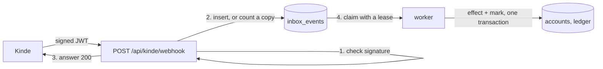

# Bottle

Write a message or a webhook now. Bottle delivers it at the time you set, once.

Bottle is also a worked example of one problem: billing state goes wrong when webhook delivery is retried, duplicated or interrupted. The intake that keeps Bottle's own Kinde billing events correct is in this repository, and the [Engine Room](src/app/engine-room/page.tsx) page shows it running.

## What it does

- **Messages.** Write an email to yourself or to someone else, and choose when it arrives.
- **Webhooks.** Schedule an HTTP POST to your server. Each try carries the same `Idempotency-Key`.
- **Terminal.** Schedule a bottle for your own terminal. `bottle listen` receives it.
- **Relay.** Point your own Kinde app's webhooks at Bottle. It checks each signature, keeps one copy of each event, and `bottle listen` forwards it to your machine.
- **CLI.** Sign in with Kinde's device flow and do all of the above from a terminal.
- **API.** Create, list and cancel bottles with a Kinde access token.
- **Engine Room.** Send one test account three billing events as nine copies, in the wrong order, with a failure in the middle, and read the result.

## Run it

You need Node 22.

```bash
npm install
npm run dev
```

Open http://localhost:3000. With no settings, Bottle uses a local Postgres in `~/.bottle/pg`, a local account, and prints emails in the server log.

```bash
npm test
```

The tests run against an in-process Postgres. They need no database server.

## The CLI

The CLI is in [`cli/`](cli). Build it and run it against the local server:

```bash
npm run bottle -- login
npm run bottle -- send "Stand-up in 5" --in 2m --terminal
npm run bottle -- listen
```

With no Kinde settings, `login` signs in to the local account. With Kinde set up, it shows a code and a link, and you approve the sign-in in the browser.

| Command | Does |
| --- | --- |
| `bottle login` | Sign in with Kinde's device flow. |
| `bottle send <message> --in 10m` | Store a bottle. Add `--to`, `--webhook <url>` or `--terminal`. `--at 09:00` also works. |
| `bottle ls` | List the bottles that are waiting. `--all` shows every bottle. |
| `bottle cancel <id>` | Cancel a bottle and get the unit back. |
| `bottle relay` | Show your relay address. `--kinde-domain myapp.kinde.com` sets the domain it accepts. |
| `bottle listen` | Receive terminal bottles and relayed Kinde webhooks. `--forward <url>` posts each one to a local server. |
| `bottle whoami` | Show your account, plan and bottles left. |

Every command takes `--json`. `bottle listen --json` writes one JSON object for each event, so a script or an AI agent can read it. Exit codes: 0 done, 1 failed, 2 wrong usage, 3 not signed in, 130 stopped.

### Test your Kinde webhook handler on your machine

```bash
bottle relay --kinde-domain myapp.kinde.com
# In Kinde: Settings > Webhooks > Add webhook, with the address from the line above
bottle listen --forward http://localhost:3000/api/webhooks
```

Your handler gets the signed JWT exactly as Kinde sent it, with the `webhook-id` header. When Kinde retries, Bottle keeps one copy and tells you how many came (`bottle-copies`). Your handler gets the event once.

To see what your handler does when a delivery is lost, run `bottle listen --forward <url> --drop 1`. The first delivery gets no answer, the lease ends after 30 seconds, and the same event comes again with the same `webhook-id`. A handler that does the work twice has a bug that this shows.

## How the intake works

Every event from outside goes through four rules. The code is in [`src/lib/intake.ts`](src/lib/intake.ts) and [`src/lib/billing.ts`](src/lib/billing.ts).



1. **Store, then answer.** The endpoint checks the signature, writes the event, and only then answers 200. Kinde retries until it gets a 200.
2. **One key for each event.** Kinde's `webhook-id` header stays the same on every retry. `(source, dedupe_key)` is unique, so a second copy adds one to `seen_count` and does nothing else.
3. **The effect and the mark commit together.** A worker claims events with `FOR UPDATE SKIP LOCKED` and a lease, and applies each one in a transaction. If the worker stops half way, the database rolls back and the event runs again when the lease ends.
4. **Effects are safe to repeat.** A quota grant is a ledger row with a unique key for the account and the month. A plan change applies only if it is newer than the one stored. A replay changes nothing.

Bottles use the same pattern on the way out: a lease, retries with back-off, and one id for every try.

## Decisions

- **Postgres, and nothing else.** The queue, the dedupe rule and the ledger are all tables. One transaction can cover "apply the event" and "mark it applied", which a separate queue cannot do.
- **Plain SQL.** The queries are the interesting part, so they are written out and not hidden behind an ORM.
- **PGlite for development and tests.** It is real Postgres in the Node process, so `npm run dev` and `npm test` work on a fresh clone.
- **Two layers of safety.** The delivery key stops a copy of the same delivery. The ledger key stops the same fact from counting twice when it arrives as two different deliveries.
- **A separate ticker.** A Cloudflare Worker with a cron trigger calls `/api/tick` once a minute. The web app has no long-running process.

## Configuration

Copy `.env.example` to `.env.local`. Each value is explained in the file.

| Value | Needed for |
| --- | --- |
| `DATABASE_URL` | A hosted Postgres. Run `npm run db:migrate` once after you set it. |
| `KINDE_*` | Sign-in and billing events. |
| `KINDE_DEVICE_CLIENT_ID` | CLI sign-in. Make a "Device and IoT" application in Kinde, and turn on Email + code for it. |
| `RESEND_API_KEY`, `BOTTLE_FROM` | Email delivery. |
| `TICK_SECRET` | The ticker in production. |

In Kinde, add a webhook that points to `/api/kinde/webhook` and select the `customer.*` billing events.

## API

```bash
curl -X POST https://your-bottle/api/v1/bottles \
  -H "Authorization: Bearer $KINDE_ACCESS_TOKEN" \
  -H "Idempotency-Key: freeze-2026-10-16" \
  -H "Content-Type: application/json" \
  -d '{"kind":"webhook","target":"https://hooks.example.com/deploys","body":"{\"text\":\"Deploy freeze ends\"}","deliver_at":"2026-10-16T09:00:00Z"}'
```

| Method | Path | Does |
| --- | --- | --- |
| `POST` | `/api/v1/bottles` | Store a bottle. The same `Idempotency-Key` returns the first bottle. |
| `GET` | `/api/v1/bottles` | List your bottles. |
| `DELETE` | `/api/v1/bottles/:id` | Cancel a bottle that has not gone out. |
| `GET` | `/api/v1/me` | Your account, plan and bottles left. |
| `GET`, `POST` | `/api/v1/relay` | Your relay address. `POST { "kinde_domain": "…" }` sets the domain. |
| `POST` | `/api/relay/:relay_id` | Where your Kinde app sends its webhooks. |
| `POST` | `/api/v1/listen` | Claim the due terminal bottles and relay events, each with a 30-second lease. |
| `POST` | `/api/v1/listen/:id` | Answer for one attempt: `{ "attempt": 1, "ok": true }`. |

## Limits

- Free: 10 bottles a month. Pro: 500.
- A message can be 20,000 characters.
- A delivery time can be up to five years ahead.
- Webhook addresses must use `https` and must not point into a private network.

## Licence

MIT. See [LICENSE](LICENSE).
